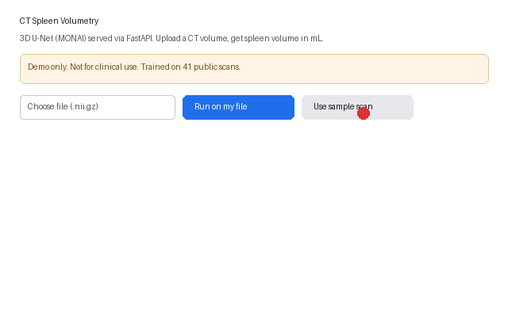
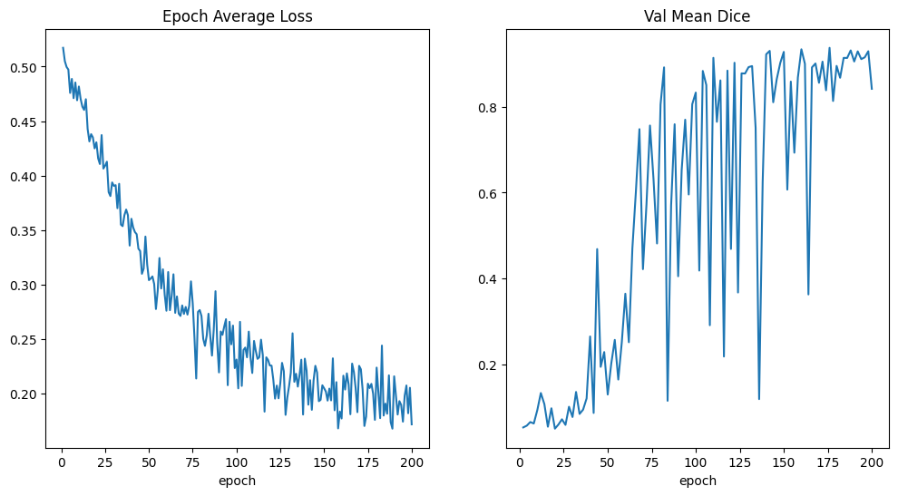
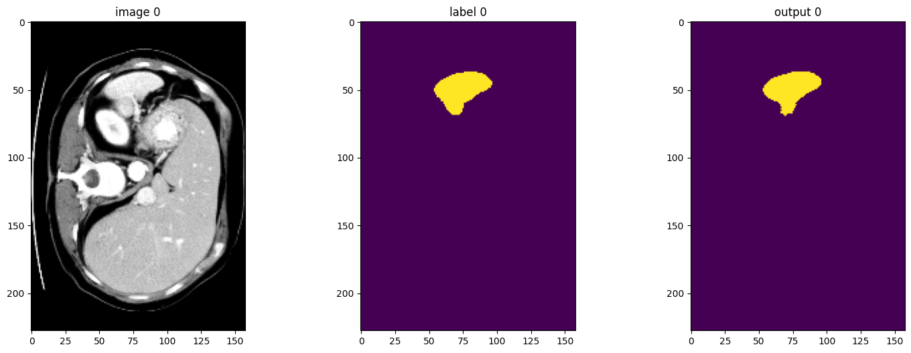

# CT Spleen Segmentation API

A 3D U-Net that segments the spleen from abdominal CT scans, served through a FastAPI service that returns the spleen volume as structured JSON.

Upload a CT volume (NIfTI), get back the spleen volume in mL.

> **Not clinical software.** This is a portfolio project trained on a small public dataset. It has not been validated on hospital data and must not be used for any medical decision.

---

## Demo


*Browser UI demonstration showing one-click sample inference, CPU loading state, and structured volumetry card.*

> **Screen capture note:** You can record your own live interaction using free tools like [ScreenToGif](https://www.screentogif.com/) (Windows) or Gifski (macOS/Linux) and save it to `docs/images/demo.gif`.

---

## Web demo

The platform provides a modern dark-theme medical imaging dashboard hosted on **`http://localhost:3000`**:

1. Start the Docker stack:
   ```bash
   docker compose up -d
   ```
2. Open [http://localhost:3000](http://localhost:3000) in your browser.
3. Click **"Try sample scan"** for an immediate test run, or drag and drop any `.nii` / `.nii.gz` CT volume.
4. **Note on CPU Latency**: Full 3D abdominal volumes take **20–30 seconds** on CPU due to 3D sliding-window patch convolutions. The built-in smoke test scan completes in ~2–3 seconds.

---

## What it does

1. Accepts a CT volume (`.nii` / `.nii.gz`) via `POST /predict`.
2. Preprocesses it: RAS orientation, resampling to 1.5 x 1.5 x 2.0 mm, CT intensity clipping to [-57, 164] HU, foreground crop.
3. Runs sliding-window 3D U-Net inference (160 x 160 x 160 patches).
4. Maps the predicted mask back to the original image space using MONAI `Invertd`.
5. Computes spleen volume = voxel count x voxel volume (from the NIfTI header spacing).
6. Returns structured JSON with automated sanity checks.

---

## Results

| Metric | Value |
|---|---|
| Validation Dice (best checkpoint, resampled space) | 0.9375 |
| Validation Dice (original image spacing) | 0.9427 |
| **CPU Inference Latency** | **23.0 s** (`spleen_15`, $512 \times 512 \times 38$ volume on CPU) |

**Read this before trusting the number:**
- Dataset: Medical Segmentation Decathlon, Task09 Spleen (41 labeled CT scans, ~1.50 GB archive).
- Split: 32 train / 9 validation. **There is no separate held-out test set.**
- The best checkpoint (epoch 176 of 200) was selected using the validation score, so the reported Dice is optimistically biased. Treat it as an upper estimate, not a generalization measure.
- Nine validation scans is a small sample. Variance across scans is high.

### Visualizations


*Figure 1: Epoch Average Loss and Validation Mean Dice across 200 epochs (best metric 0.9375 at epoch 176).*


*Figure 2: Validation case at axial slice 80 — Original CT, validation label, and 3D U-Net predicted mask.*

---

## Different-spacing test

To verify that the predicted segmentation mask is accurately mapped back to native space (rather than evaluated in resampled $1.5 \times 1.5 \times 2.0\text{ mm}$ space), the API was tested on **`spleen_15`**:
- **Native Scan Spacing**: $0.74 \times 0.74 \times 5.0\text{ mm}$ ($\text{voxel volume} \approx 2.74\text{ mm}^3$ vs resampled $4.50\text{ mm}^3$)
- **Native Dimensions**: $512 \times 512 \times 38$
- **Colab reference prediction (`spleen_volumes.json`)**: **111.7 mL**
- **API `/predict` Measured Output**: **111.7 mL** (40,788 voxels $\times 2.7397\text{ mm}^3 / 1000 = 111.748\text{ mL}$)

$$\text{API Output: } 111.7\text{ mL} \equiv \text{Colab Reference Prediction: } 111.7\text{ mL}$$

This check shows the API and the training notebook agree. It confirms the API matches the notebook pipeline in native space (it does not prove the volume is anatomically correct, as `spleen_15` comes from the unlabeled test set).

---

## Model and training

- Architecture: MONAI 3D `UNet` (channels 16-32-64-128-256, strides 2, 2 residual units, BatchNorm), 2 output classes.
- Loss / metric: Dice.
- Training: 200 epochs on a Google Colab T4 GPU, based on the official MONAI spleen segmentation tutorial.
- Contribution of this repo beyond the tutorial: the inference pipeline, coordinate inversion, volume calculation, non-blocking async API, sanity checks, tests, and Docker packaging.

---

## API

### `GET /`
Serves the web demo single-page application (`static/index.html`).

### `GET /health`
```json
{
  "status": "ok",
  "model_loaded": true,
  "device": "cpu",
  "model": "unet3d-msd-spleen"
}
```

### `POST /predict`
Multipart upload with a `file` field containing a `.nii` or `.nii.gz` CT volume.

```bash
curl -F "file=@scan.nii.gz" http://localhost:8000/predict
```

Response payload (real output from `spleen_15`):
```json
{
  "spleen_volume_ml": 111.7,
  "voxels": 40788,
  "spacing_mm": [0.7402340173721313, 0.7402340173721313, 5.0],
  "needs_review": false,
  "review_reasons": [],
  "connected_components": 1,
  "model": "unet3d-msd-spleen"
}
```

- **Execution Latency**: 23.00 seconds on CPU.
- `needs_review` is `true` when the mask is empty, fragmented across disconnected components, or the volume is outside a plausible range (<30 mL or >650 mL), so a human checks the result instead of trusting it.
- `review_reasons` provides transparent diagnostic explanations if flagged.
- `connected_components` detects potential accessory spleens or false-positive segmentation islands.

### `POST /predict/sample`
Executes inference on the built-in sample scan without needing file upload:

```bash
curl -X POST http://localhost:8000/predict/sample
```

### Bad upload returns 400, not 500
Non-NIfTI uploads (such as uploading `README.md`) are rejected immediately with `400 Bad Request`:

```bash
curl -F "file=@README.md" http://localhost:8000/predict
```

Response (`HTTP 400`):
```json
{
  "detail": "Invalid file format for 'README.md'. Only NIfTI volumes (.nii.gz or .nii) are supported."
}
```

### `POST /predict/mask` (Optional)
Returns the generated binary segmentation mask as a downloadable NIfTI file (`.nii.gz`), preserved in the original scan's orientation and affine matrix:

```bash
curl -X POST "http://localhost:8000/predict/mask" \
  -F "file=@scan.nii.gz" \
  --output predicted_spleen_mask.nii.gz
```

---

## Run locally

```bash
pip install -r requirements.txt
uvicorn app.main:app --reload
```

## Run with Docker

### 1. Start the Application (Recommended)

Starts both the Nginx Frontend (`http://localhost:3000`) and the FastAPI Backend (`http://localhost:8000`):

```bash
docker compose up -d
```

*(If you updated code and want to rebuild before running, use `docker compose up -d --build`)*

### 2. Verify Container Status

```bash
docker compose ps
```

You should see both containers with `healthy` status:
- **`ct-spleen-frontend`** on port `3000`
- **`ct-spleen-backend`** on port `8000`

### 3. Access Endpoints

- **Frontend Dashboard (Web UI)**: [http://localhost:3000](http://localhost:3000)
- **Backend Swagger API Docs**: [http://localhost:8000/docs](http://localhost:8000/docs)
- **Health Check**: [http://localhost:3000/health](http://localhost:3000/health) or [http://localhost:8000/health](http://localhost:8000/health)

### 4. Useful Docker Commands

| Action | Command |
| :--- | :--- |
| **Start everything** | `docker compose up -d` |
| **Stop everything** | `docker compose down` |
| **Restart services** | `docker compose restart` |
| **Clean restart (if stuck)** | `docker compose down && docker compose up -d` |
| **View live logs** | `docker compose logs -f` |
| **Run test suite inside container** | `docker exec ct-spleen-backend pytest -v tests/` |

### Option 2: Standalone Single Container Mode

If you prefer running a single container without Compose:

```bash
docker build -t ct-spleen-api .
docker run -d --name ct-spleen-api -p 8000:8000 ct-spleen-api
```

---

## Tests

```bash
pytest -v tests/
```

### Test data and requirements for cloners
- **Smoke test scan (`data/sample_ct.nii.gz`)**: A small synthetic CT volume included in the repository, used solely as a CI smoke test to verify server startup, tensor shape handling, and endpoint routing without distributing patient scans.
- **Out of the box**: 20 of 21 tests pass immediately using only `sample_ct.nii.gz` and the static web UI.
- **Different-spacing test (`test_predict_different_spacing_accuracy`)**: Specifically validates `spleen_15.nii.gz` against `spleen_volumes.json`. If `spleen_15.nii.gz` is not in `data/`, this test automatically skips so cloners will not experience test failures. To run it, place `spleen_15.nii.gz` into `data/`.

---

## Repo Hygiene

- **Minimal Scan Footprint**: Only the lightweight synthetic smoke test volume (`data/sample_ct.nii.gz`, ~500 KB) is tracked in Git.
- **Docker Isolation**: `.dockerignore` and `.gitignore` exclude raw dataset archives, full patient CT volumes, and temporary prediction masks from being shipped into the Docker image or committed to version control.

---

## Limitations

- One organ only (spleen), trained on 41 public scans.
- No separate test set, so generalization is unmeasured.
- Single data source: untested on other scanners, protocols, contrast phases, or pathology.
- NIfTI only. No DICOM ingestion.
- No lesion or tumor handling. Volume is a single organ measurement, not a diagnostic output.
- No authentication, audit logging, or monitoring.

## What production would require

- DICOM ingestion and de-identification.
- External validation on multi-site data with a proper held-out test set.
- Failure-case review (patients with splenomegaly, splenectomy, or atypical anatomy).
- Audit trail, versioned models, and regulatory traceability.
- Human review workflow for flagged cases.

## Tech stack

Python, PyTorch, MONAI, nibabel, scipy, FastAPI, Docker, pytest.

## Data and credits

- Dataset: Medical Segmentation Decathlon, Task09 Spleen.
- Training approach adapted from the MONAI spleen segmentation tutorial.
